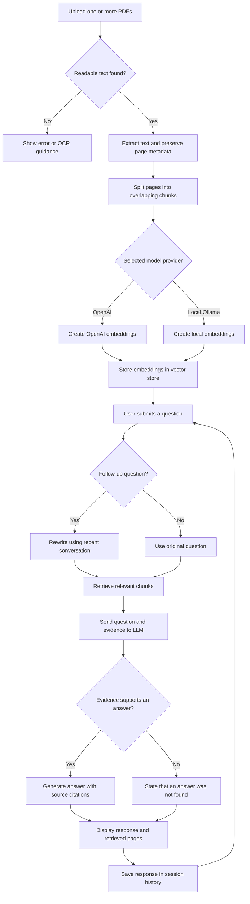

# LangChain RAG Flow — PDF Study Assistant

This project is a PDF Study Assistant built using Streamlit and LangChain. It allows users to upload lecture notes, textbooks, or research papers and ask questions about their contents. Users can also request simple explanations, topic summaries, and quiz questions. The application uses Retrieval-Augmented Generation (RAG), which supplies relevant document passages to a language model before it generates an answer.

The workflow begins with Streamlit’s file uploader, which accepts one or more PDF documents. The application extracts text from each PDF using pypdf. Each extracted page becomes a LangChain Document containing the text and metadata, including the filename and PDF page number. Pages without readable text are flagged because scanned documents may require optical character recognition.

Next, LangChain’s RecursiveCharacterTextSplitter divides the extracted text into smaller, overlapping chunks. The default configuration uses approximately 1,200 characters per chunk with a 200-character overlap. Overlap helps preserve information near chunk boundaries. Splitting occurs within individual pages, allowing each chunk to retain an identifiable source page.

The chunks are converted into numerical embeddings. In OpenAI mode, the application uses OpenAIEmbeddings; alternatively, users can select an installed local embedding model through Ollama. These representations are stored in LangChain’s InMemoryVectorStore, which supports searching for passages related to a question.

When a user submits a question, the application retrieves the most relevant chunks using vector similarity. For follow-up questions, recent conversation history helps rewrite the question into a standalone retrieval query. This improves handling of references such as “explain that method,” while keeping the uploaded documents as the evidence source.

An explicit LangChain chain connects the retriever, source preparation, prompt, model invocation, and output parser. The prompt combines the question, selected study mode, and retrieved passages. It instructs the language model to answer only from the supplied evidence, cite source identifiers, and acknowledge when the retrieved passages do not contain an answer. These instructions reduce unsupported responses but cannot guarantee that every generated claim is correct.

Finally, Streamlit displays the answer in a chat interface alongside the exact retrieved chunks, filenames, and page numbers. Conversation history is retained within the session, and users can download the discussion with its evidence. OpenAI credentials are loaded from `.env` or entered through a masked input field, without hard-coded secrets. This design makes the assistant useful for studying while allowing users to inspect the evidence behind its responses.

## Workflow and Decision Chart

**Implementation note:** The evidence-support decision is an instruction
followed by the language model, not a separately validated factual check.
Users should review the displayed source passages to verify the answer.